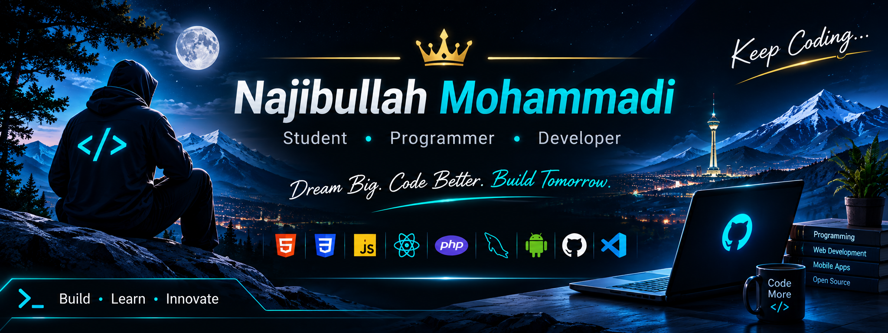

<!-- PROFILE BANNER -->

  

<h1 align="center">
  Hi, I'm Najibullah Mohammadi
</h1>

<h3 align="center">
  Student • Programmer • Developer
</h3>

  Building, Learning, and Innovating.

  
  
  

---

## About Me

I'm **Najibullah Mohammadi**, a student and programmer passionate about technology, software development, and building useful digital products.

- Currently learning and improving my programming skills.
- Interested in web development and mobile applications.
- Building personal projects and exploring new technologies.
- Always looking for opportunities to learn and improve.

## Tech Stack

  

## Featured Project

<table>
<tr>
<td width="100%">

<h3>Hesab Dar | حساب‌دار</h3>

A personal finance manager designed to help users track income, expenses, unpaid earnings, and financial reports.

- Offline-first experience
- Persian and English support
- Light and dark themes
- Financial reports and transaction management

  
  
  

</td>
</tr>
</table>

## GitHub Statistics

  
  

  

## GitHub Overview

  
  

  

## Connect With Me

  <a href="https://www.instagram.com/rayesnajib">
    Instagram: @rayesnajib
  </a>
    
  <a href="https://t.me/RayesNajib">
    Telegram: @RayesNajib
  </a>
    
  <a href="https://najib-ullah.netlify.app">
    Official Website
  </a>

---

<h3 align="center">
  Dream Big. Code Better. Build Tomorrow.
</h3>

  © 2026 Najibullah Mohammadi

<!--
**RayesNajib/RayesNajib** is a ✨ _special_ ✨ repository because its `README.md` (this file) appears on your GitHub profile.

Here are some ideas to get you started:

- 🔭 I’m currently working on ...
- 🌱 I’m currently learning ...
- 👯 I’m looking to collaborate on ...
- 🤔 I’m looking for help with ...
- 💬 Ask me about ...
- 📫 How to reach me: ...
- 😄 Pronouns: ...
- ⚡ Fun fact: ...
-->
